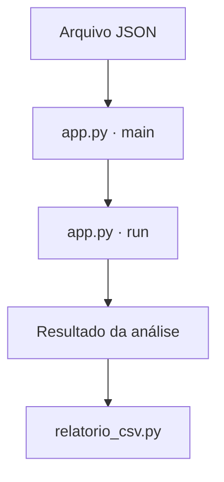

# Engenharia reversa e estudo — Registro de ocorrências de trânsito

## Objetivo e fluxo

Filtro de ocorrências locais pela validade das informações. Em app.py, data_iso valida datas e run seleciona registros ativos. busca gera a URL de referência com a posição descrita.

**Tecnologias identificadas** · Python.

**Revisão de referência** · `150422379828`.

## Mapa do código

| Caminho | Papel de leitura | Símbolos selecionados |
| --- | --- | --- |
| [app.py](../app.py) | Ponto de leitura para entrada ou composição | `texto`, `inteiro`, `_url`, `busca`, `data_iso`, `run`, `objeto_sem_campos_repetidos`, `rejeitar_constante_json`, `main` |
| [relatorio_csv.py](../relatorio_csv.py) | Implementação | `celula`, `linhas`, `escrever_csv` |

## Roteiro de estudo e desenvolvimento

1. Comece pelo fluxo descrito acima e localize seus pontos de entrada no mapa. Acompanhe uma entrada válida até a transformação ou a resposta.
2. Abra um teste relacionado ao fluxo e descreva qual regra ele protege. Compare o tratamento esperado para entradas válidas, inválidas e nos limites.
3. Ao adicionar uma regra, determine qual módulo controla o dado e cubra o caso nesse nível. Em seguida, confira o efeito no comando, na API ou na interface de entrada.

**Pergunta de entrevista**

Como testar uma ocorrência cuja vigência termina hoje sem depender do relógio real?

## Testes versionados

Arquivos para começar a leitura dos cenários de teste: [test_address_validation.py](../test_address_validation.py), [test_app.py](../test_app.py), [test_regressoes.py](../test_regressoes.py), [test_saida_csv.py](../test_saida_csv.py), [test_stdin.py](../test_stdin.py).

Os comandos e versões de runtime usados no CI ficam em [.github/workflows/tests.yml](../.github/workflows/tests.yml).

[Voltar ao README](../README.md).
